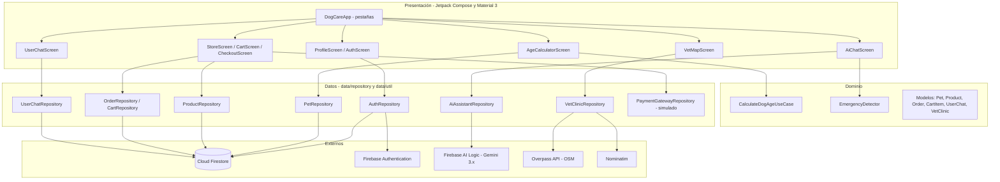

# Arquitectura de DogCare

Documento vigente: `DOCUMENTACION DogCare/02_ARQUITECTURA_Y_DISENO/Arquitectura_Software_DogCare` (DOCX y PDF). Resumen fiel al código:

Notas: no hay ViewModels (el estado vive en los Composables y repositorios); no hay base local (Room se retiró por no usarse); la validación de precios y existencias ocurre en el cliente dentro de una transacción de Firestore.
