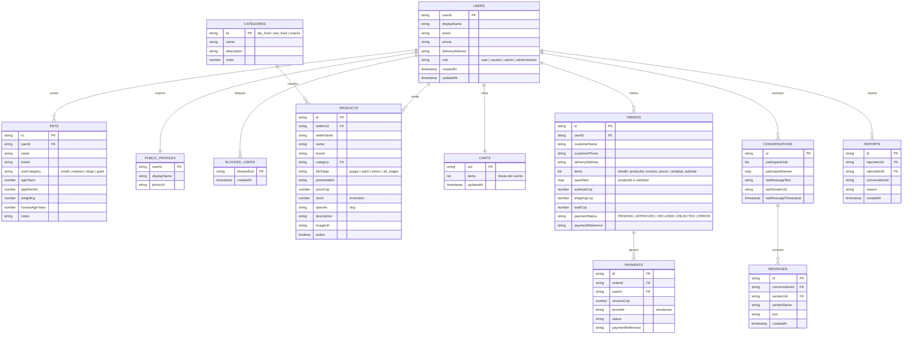

# Modelo de datos de Firestore — DogCare

Base de datos: Cloud Firestore (modo nativo) del proyecto Firebase `Jarvis` (`gen-lang-client-0991918834`), base `ai-studio-android-dogcare-10fa4e75-6cda-4ff9-a467-a58e8e73db8e`. Las reglas están en `firestore.rules` y se probaron con 23 pruebas en el emulador (`firestore.test.js`).

## Entidades de la guía y su ubicación

La guía (Punto 10) exige 11 entidades. Dos no son colecciones propias; se documenta por qué.

| Entidad de la guía | Dónde está | Justificación |
|---|---|---|
| Usuarios | `users/{uid}` (+ `publicProfiles/{uid}`) | Perfil privado y perfil público separados: el público solo tiene nombre y foto, para el directorio del chat |
| Perros registrados | `users/{uid}/pets/{petId}` | Subcolección: pertenece a un solo usuario |
| Productos | `products/{productId}` | Cada producto lleva `sellerUid` y `sellerName` (marketplace multi-vendedor) |
| Categorías de alimentos | `categories/{id}` | Tres categorías fijas (`dry_food`, `wet_food`, `snacks`); sin escritura desde la app |
| Inventario | Campo `stock` de `products/{productId}` | Hay un único inventario por producto; una colección aparte duplicaría el dato y obligaría a mantener dos documentos consistentes en cada compra |
| Carrito de compras | `carts/{uid}` | Un carrito por usuario (`items`: lista de líneas) |
| Pedidos | `orders/{orderId}` | Cabecera del pedido |
| Detalles de pedidos | Campos `items` (lista) y `quantities` (mapa) de `orders/{orderId}` | Se guarda una copia del nombre y precio de cada producto en el momento de la compra: preserva el resumen original aunque el vendedor cambie el producto después |
| Pagos | `payments/{paymentId}` | Comprobante inmutable (sin update ni delete) |
| Conversaciones | `conversations/{conversationId}` | Dos participantes (`participantUids`) |
| Mensajes | `conversations/{conversationId}/messages/{messageId}` | Subcolección, solo de lectura y creación (sin edición ni borrado) |

Colecciones adicionales justificadas por requisitos propios: `users/{uid}/blockedUsers/{blockedUid}` (bloqueo entre usuarios) y `reports/{reportId}` (reportes).

## Diagrama entidad-relación

## Reglas de acceso resumidas

| Colección | Lectura | Escritura |
|---|---|---|
| `users/{uid}` | Dueño o admin | Dueño; el rol no se puede asignar ni cambiar desde la app (solo desde la consola) |
| `users/{uid}/pets` | Dueño o admin | Dueño (validado) |
| `users/{uid}/blockedUsers` | Solo el dueño | Solo el dueño; no se puede bloquear a uno mismo |
| `publicProfiles/{uid}` | Cualquier usuario autenticado | Dueño, solo campos públicos |
| `products` | Pública | Cualquier usuario autenticado crea productos propios (`sellerUid` = su UID, inmutable); solo el vendedor edita o elimina; un comprador solo puede descontar stock ligado a su pedido (PENDING a APPROVED) |
| `categories` | Pública | Nadie desde la app |
| `carts/{uid}` | Dueño | Dueño |
| `orders` | Dueño o admin | Crea el dueño en `PENDING`; el dueño pasa una única vez a un estado final con `paymentReference`; no puede cambiar `totalCop`, `items` ni `userId` |
| `payments` | Dueño del pedido o admin | Crear con monto y estado iguales a los del pedido; inmutable |
| `conversations` y `messages` | Solo participantes | Solo participantes; el remitente debe ser quien escribe; se rechaza si el otro participante lo bloqueó |
| `reports` | Solo admin | Cualquier usuario autenticado crea el suyo (`reporterUid` = su UID) |

## Limitaciones conocidas

- **Pago simulado:** no hay pasarela real. El cliente decide el estado del pago; las reglas no pueden verificar que el pago haya ocurrido ni que `totalCop` coincida con los precios de `products`. Validarlo exige una capa de servidor (Cloud Functions, plan Blaze). Se acepta y se declara como simulación.
- **Productos antiguos** sin `sellerUid` no se pueden editar ni eliminar desde la app; se borran desde la consola de Firebase.
- **Rol admin:** se asigna escribiendo el campo `role` del documento `users/{uid}` desde la consola de Firebase. La app lo usa solo para consultar usuarios y reportes.
- **Reglas:** son un prototipo probado con 23 casos; deben revisarse antes de exponer la aplicación a un público amplio.
